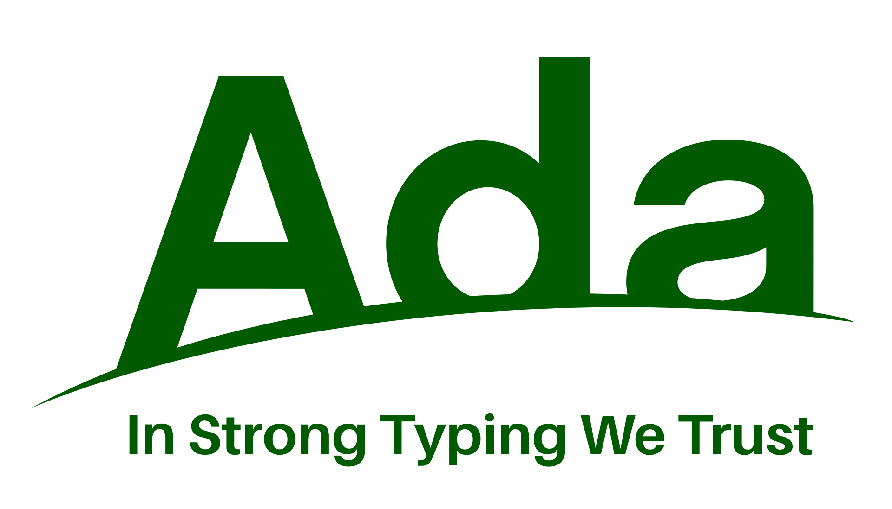
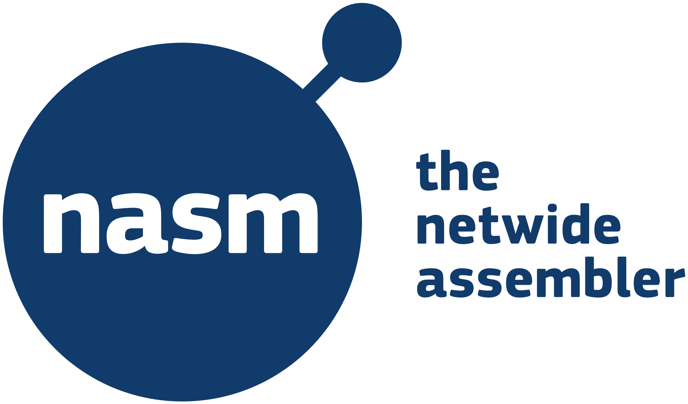
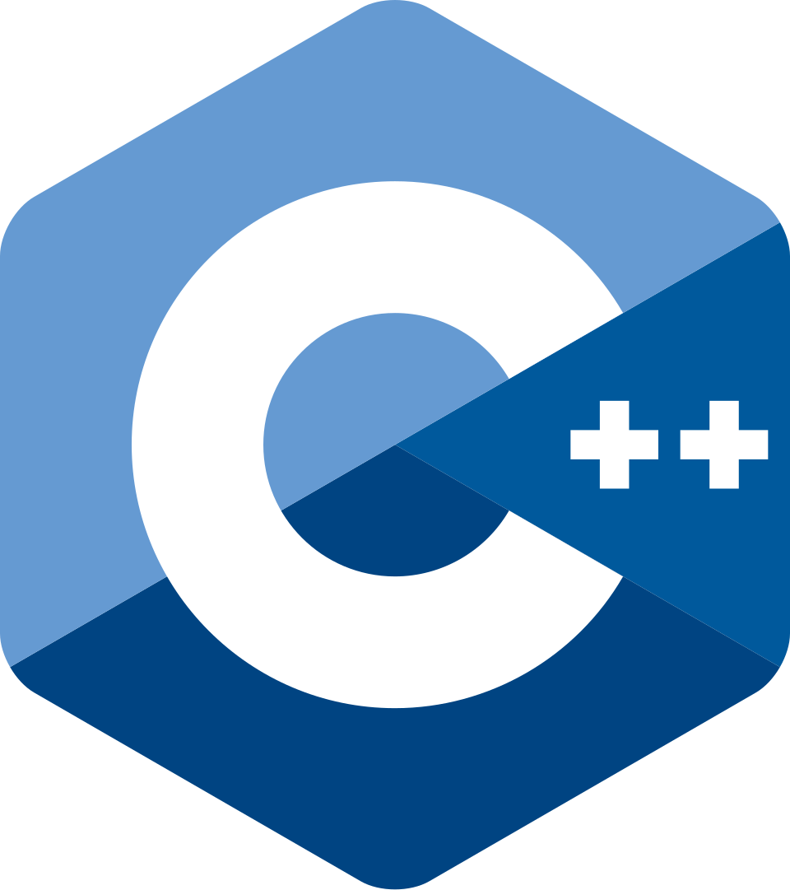

# Why not throw a bunch of compiled languages together in the same executable ?

This PoC is an experiment to try this silly idea and see how much it works.  

The program entry point is in C (`main()` function), and it calls individual functions from multiple languages :  
- Ada: 
- Assembly (NASM) 
- C 
- C++ 
- C# 
- COBOL *
- D 
- FORTRAN 
- Go 
- Haskell 
- HolyC 
- Rust 
- Zig 

<br>
* I didn't find any logo

# Run

On Fedora, install those packages :  
```bash
sudo dnf install dotnet-sdk-10.0 gfortran gnat gcobol rust go ghc
```

The build is tested with Docker images.  
Beware, they will take a LOT of disk space as many languages toolchains are installed.  
Here are the commands :  
```bash
# Install Docker
sudo dnf install docker

# Initialize Docker
sudo systemctl enable docker
sudo systemctl start docker

# Run Docker images (takes a LOT of disk space)
make docker

# Remove Docker images (frees disk space)
make docker-clean
```
